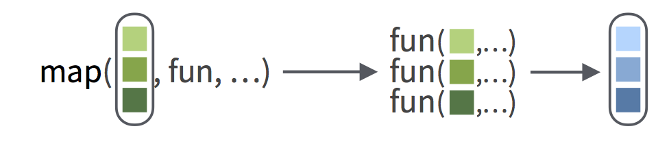



```{r}
#| include: false
library(tidyverse)
library(stringr)

ldeaths <- list(`1974` = c(Jan = 3035, Feb = 2552, Mar = 2704, Apr = 2554, May = 2014, Jun = 1655, Jul = 1721, Aug = 1524, Sep = 1596, Oct = 2074, Nov = 2199, Dec =  2512),
                `1975` = c(Jan = 2933, Feb = 2889, Mar = 2938, Apr = 2497, May = 1870, Jun = 1726, Jul = 1607, Aug = 1545, Sep = 1396, Oct = 1787, Nov = 2076, Dec =  2837),
                `1976` = c(Jan = 2787, Feb = 3891, Mar = 3179, Apr = 2011, May = 1636, Jun = 1580, Jul = 1489, Aug = 1300, Sep = 1356, Oct = 1653, Nov = 2013, Dec =  2823),
                `1977` = c(Jan = 3102, Feb = 2294, Mar = 2385, Apr = 2444, May = 1748, Jun = 1554, Jul = 1498, Aug = 1361, Sep = 1346, Oct = 1564, Nov = 1640, Dec =  2293),
                `1978` = c(Jan = 2815, Feb = 3137, Mar = 2679, Apr = 1969, May = 1870, Jun = 1633, Jul = 1529, Aug = 1366, Sep = 1357, Oct = 1570, Nov = 1535, Dec =  2491),
                `1979` = c(Jan = 3084, Feb = 2605, Mar = 2573, Apr = 2143, May = 1693, Jun = 1504, Jul = 1461, Aug = 1354, Sep = 1333, Oct = 1492, Nov = 1781, Dec =  1915))
                

knitr::opts_chunk$set(error = TRUE, out.width = "100%")
```

```{webr}
#| include: false
ldeaths <- list(`1974` = c(Jan = 3035, Feb = 2552, Mar = 2704, Apr = 2554, May = 2014, Jun = 1655, Jul = 1721, Aug = 1524, Sep = 1596, Oct = 2074, Nov = 2199, Dec =  2512),
                `1975` = c(Jan = 2933, Feb = 2889, Mar = 2938, Apr = 2497, May = 1870, Jun = 1726, Jul = 1607, Aug = 1545, Sep = 1396, Oct = 1787, Nov = 2076, Dec =  2837),
                `1976` = c(Jan = 2787, Feb = 3891, Mar = 3179, Apr = 2011, May = 1636, Jun = 1580, Jul = 1489, Aug = 1300, Sep = 1356, Oct = 1653, Nov = 2013, Dec =  2823),
                `1977` = c(Jan = 3102, Feb = 2294, Mar = 2385, Apr = 2444, May = 1748, Jun = 1554, Jul = 1498, Aug = 1361, Sep = 1346, Oct = 1564, Nov = 1640, Dec =  2293),
                `1978` = c(Jan = 2815, Feb = 3137, Mar = 2679, Apr = 1969, May = 1870, Jun = 1633, Jul = 1529, Aug = 1366, Sep = 1357, Oct = 1570, Nov = 1535, Dec =  2491),
                `1979` = c(Jan = 3084, Feb = 2605, Mar = 2573, Apr = 2143, May = 1693, Jun = 1504, Jul = 1461, Aug = 1354, Sep = 1333, Oct = 1492, Nov = 1781, Dec =  1915))
                

```

## Map


The `map()` function comes in the purrr package. purrr is a package of tools that can help you apply functions in an iterative way.

purrr is installed when you run `install.packages("tidyverse")`.  
purrr is loaded when you run `library(tidyverse)`

* Load purrr now (it is already installed). Then click Run Code.

```{webr}
#| exercise: purrr

```

```{webr}
#| exercise: purrr
#| check: true
'Purrr-fect. Now you can use purrr functions. You can also install and load the purrr package by itself, without the other tidyverse packages. To do so, use install.packages("purrr") and library(purrr).'
```

```{webr}
#| exercise: purrr
#| solution: true
library(tidyverse)
```


### map()

The job of purrr's `map()` function is to apply an R function to each element of an R vector. `map()` requires two arguments, in this order: 

1. A vector to iterate over. `map()` works with simple vectors as well as lists.  
2. A function to apply to each element in the vector. Give `map()` the name of the function without quotes around it and without parentheses behind it.

Here, `map()` applies the absolute value function to each element of `negatives`.  

```{r echo = TRUE}
negatives <- list(-25, -31, -111)
map(negatives, abs)
```


Think of `map()` like this. Each circle of squares represents a vector, and each square represents an element of the vector:

```{r echo=FALSE, out.width = "70%"}

```


```{r echo = TRUE}
list1 <- list(1, 2, 3, 4, 5)
```

* Use the code chunk below to map `log()` over the elements of `list1`. Then click Run Code.

```{webr}
#| exercise: map1
#| setup: true
list1 <- list(1, 2, 3, 4, 5)
```

```{webr}
#| exercise: map1

```

```{r}
#| include: false
list1 <- list(1, 2, 3, 4, 5)
```

```{webr}
#| exercise: map1
#| solution: true
map(list1, log)
```

::: {.hint exercise="map1"}
Begin with map().
:::

::: {.hint exercise="map1"}
Make list1 the first argument of map().
:::

::: {.hint exercise="map1"}
Make log the second argument of map().
:::

::: {.hint exercise="map1"}
Do not put parentheses behind log. log returns the code stored in the log function. log() executes the code and returns the results, which would then be passed to map() (if log() didn't throw an error that is; log() needs an argument to execute the code successfully.)
:::

```{webr}
#| exercise: map1
#| check: true
"Excellent. You can use map() with any function to iterate over the elements of a vector. map() will return the results in a list, which means that map() can handle whatever output your function creates. Why? Because you can put anything in a list."
```

### Functional programming

It may seem weird to you that `map()` takes a function as an argument, but it is not weird at all. In R, functions are objects that can be passed around just like everything else.

These questions will help you get a feel for it.

* Use this code block as a scratch pad to help you answer the questions below.

```{webr}
#| exercise: map3

```

::::: {.quiz allow-retry="true"}
What does `log` return?

:::: {.answer}
0
::::

:::: {.answer}
An error
::::

:::: {.answer correct="true"}
The function saved in the object named `log`

::: {.message}
log is just an object that happens to contain a function. This is true for the names of all R functions. You can return the function without running it by calling the name of the function without parentheses behind it.
:::
::::

:::::

::::: {.quiz allow-retry="true"}
What does `log()` return?

:::: {.answer}
0
::::

:::: {.answer correct="true"}
An error

::: {.message}
Parentheses are the "go button" for R functions. When you place parentheses behind the name of an object that contains a function, R executes the function. Unfortunately, the log function requires an argument to do its job. We do not supply one here, so we get an error. To see the effect of parentheses more clearly, compare Sys.Date() to Sys.Date. The Sys.Date function does not require an argument.
:::
::::

:::: {.answer}
The function saved in the object named `log`
::::

:::::

::::: {.quiz allow-retry="true"}
What does `log(1)` return?

:::: {.answer correct="true"}
0

::: {.message}
This is the result of running log on 1. The parentheses execute the function saved in log and pass the function the argument 1, which we supplied between the parentheses.
:::
::::

:::: {.answer}
An error
::::

:::: {.answer}
The function saved in the object named `log`
::::

:::::


By the way, you will need to click Run Code above at least once before you can continue.

### What about the output?

You give `map()` a vector and a function. `map()` always gives you a list. The _nth_ element of the list will be the result of applying your function to the _nth_ element of your vector. 

This is convenient for two reasons:

1. `map()` can handle anything that comes out of your function, even a data frame. Why? Because you can put anything into a list.
2. `map()` is easy to use in pipes because it takes a vector as its first argument and returns a vector (a list is a type of vector). Here's an example.

* Predict what this code will return and then click Run Code.

```{webr}
#| exercise: map2
#| setup: true
list1 <- list(1, 2, 3, 4, 5)
```

```{webr}
#| exercise: map2
list1 %>% 
  map(log) %>% 
  map(round)
```

```{r}
#| include: false
list1 <- list(1, 2, 3, 4, 5)
```

::: {.hint exercise="map2"}
Just click Submit Answer to see if your prediction is correct.
:::

```{webr}
#| exercise: map2
#| check: true
"The code first took the natural log of each element with log(). It then rounded each answer to the nearest integer with round()."
```

## Inputs and Outputs

### Arguments

What if you want to pass `map()` a function that uses extra arguments? 

For example, you would give `round()` an extra argument named `digits` if you wanted to round to a certain number of digits past the decimal place, e.g. 

```{r}
round(3.141593, digits = 2)
```


You can pass extra arguments for your function _to_ `map()` as if they were arguments _of_ `map()`. `map()` will forward the arguments to your function when it calls the function. You will almost always want to name these arguments, e.g.

```{r map-args}
list1 %>% 
  map(log) %>% 
  map(round, digits = 2)
```


Can you do it? 

* Use the little known `base` argument of `log()` to compute the base 2 log of each element in `list1`. Then click Run Code.

```{webr}
#| exercise: map4
#| setup: true
list1 <- list(1, 2, 3, 4, 5)
```

```{webr}
#| exercise: map4

```

```{r}
#| include: false
list1 <- list(1, 2, 3, 4, 5)
```

```{webr}
#| exercise: map4
#| solution: true
map(list1, log, base = 2)
```

::: {.hint exercise="map4"}
Begin with map(list1, log).
:::

```{webr}
#| exercise: map4
#| check: true
"Good job. You can pass as many arguments as you like through map(), be sure to separate each with a comma, e.g. map(list1, rnorm, mean = 1, sd = 2)."
```

### Output formats

So far all of our functions have returned a list of numbers. This is a bit silly, because (as you've seen) it can be hard to work with lists.

What if you want to return the results as a simple vector (i.e. not a list)?

### map_dbl()

You could do that with `map_dbl()`. 

`map_dbl()` works exactly like `map()`, except it returns its results in a numeric vector. (dbl is short for "double", the computer name for a number that can contain a decimal).

* Change the code below to use `map_dbl()` then click Run Code.

```{webr}
#| exercise: map_dbl
#| setup: true
list1 <- list(1, 2, 3, 4, 5)
```

```{webr}
#| exercise: map_dbl
map(list1, log)
```

```{r}
#| include: false
list1 <- list(1, 2, 3, 4, 5)
```

```{webr}
#| exercise: map_dbl
#| solution: true
map_dbl(list1, log)
```

```{webr}
#| exercise: map_dbl
#| check: true
"Good job. Now your results come back as a numeric vector. This is useful. For example, you could pass the results directly to round() without using another call to map(): list1 %>% map_dbl(log) %>% round()."
```

### Other types of output

But suppose our function does not return doubles. For example, `str_sub()` from the stringr package returns characters. Here, it will return the first character in each string.

* Will the code work? Click Run Code to find out.

```{webr}
#| exercise: map_dbl2
library(stringr)
strings <- list("Mary", "John", "Jill")
map_dbl(strings, str_sub, start = 1, end = 1)
```


The code didn't work because `str_sub()` returns a set of characters, but `map_dbl()` builds a double (numeric) vector. 

In R, each non-list vector has a type. You can only save doubles in a double vector. You'd save characters in a _character vector_. Are you out of luck?


No. purrr provides eight versions of `map()`. Each returns its results in a different format. 

Function     | Output
------------ | -------------
`map()`      |  list
`map_chr()`  |  character vector
`map_dbl()`  |  double (numeric) vector
`map_dfc()`  |  data frame (output column binded)
`map_dfr()`  |  data frame (output row binded)
`map_int()`  |  integer vector
`map_lgl()`  |  logical vector
`walk()`     |  returns the input invisibly (used to trigger side effects)

The last function, `walk()`, is used for functions that do not return an output to the command line, like functions that plot graphs or save files.


The idea behind purrr is that you can choose the map function that returns the type of output that you need.

* Replace `map_dbl()` in the code below . Choose the replacement that will make the code work. Then click Run Code. 

```{webr}
#| exercise: map_chr
strings <- list("Mary", "John", "Jill")

map_dbl(strings, str_sub, start = 1, end = 1)
```

::: {.hint exercise="map_chr"}
str_sub() returns characters.
:::

```{webr}
#| exercise: map_chr
#| solution: true
strings <- list("Mary", "John", "Jill")

map_chr(strings, str_sub, start = 1, end = 1)
```

```{webr}
#| exercise: map_chr
#| check: true
"Great job. Now let's cement our knowledge of `map()` by using it to solve a data wrangling challenge."
```

## Case Study


`ldeaths` is a list that records monthly deaths in the UK from lung disease. The data spans the years 1974 to 1979, and is divided year.

* Check it out. Click Run Code to see the contents of `ldeaths`.

```{webr}
#| exercise: ldeaths-1
ldeaths
```

```{webr}
#| exercise: ldeaths-1
#| check: true
"This is the data you will explore. ldeaths is a reformatted version of the ldeaths time series that comes in base R."
```

### Deaths by year

It would be helpful to know how many people died each year from lung disease. Then you could see if deaths decreased over time. Can you find out?

* Use a map function to compute the sum of each vector in `ldeaths`. Then click Run Code.

```{webr}
#| exercise: ldeaths-sum

```

::: {.hint exercise="ldeaths-sum"}
The sums will be numbers (doubles).
:::

```{webr}
#| exercise: ldeaths-sum
#| solution: true
map_dbl(ldeaths, sum)
```

```{webr}
#| exercise: ldeaths-sum
#| check: true
"Good job. It looks like deaths went down over time (slightly). Did you use map() or map_dbl()? Both will work, but map_dbl() will return your results in a format that is easier to inspect and use."
```

### Total deaths

Take it a step further.

* Compute the _total_ number of deaths in the data set. This will be the sum of your last result. Then click Run Code.

```{webr}
#| exercise: ldeaths-total

```

::: {.hint exercise="ldeaths-total"}
This will take two steps.
:::

::: {.hint exercise="ldeaths-total"}
The second step will be easier if you use map_dbl() in your first step.
:::

```{webr}
#| exercise: ldeaths-total
#| solution: true
sum(map_dbl(ldeaths, sum))
```

```{webr}
#| exercise: ldeaths-total
#| check: true
"Good work. First, you summed each vector. Then, you summed the results. It is easiest to sum the results if you use map_dbl() to sum the vectors."
```

### Pipes

Now that you are doing multi-step operations, you should begin using the pipe operator if you aren't already. The pipe operator (`%>%`) is great for single step operations too.

* Take a moment to convert this code to use the pipe operator. Then click Run Code.

    Note: Recall that the pipe operator takes the output of whatever is on its left hand side and passes it to the first argument of the function that is on its right hand side. So `x %>% f()` is the same as `f(x)` and `x %>% f() %>% g()` is the same as `g(f(x))`.

```{webr}
#| exercise: ldeaths-pipe
sum(map_dbl(ldeaths, sum))
```

::: {.hint exercise="ldeaths-pipe"}
You will need to use two pipe operators to convert this expression into a pipe.
:::

```{webr}
#| exercise: ldeaths-pipe
#| solution: true
ldeaths %>% 
  map_dbl(sum) %>%
  sum()
```

```{webr}
#| exercise: ldeaths-pipe
#| check: true
"Use pipes for the rest of this case study. Pipes make it easy to build on previous work and to transform your data one step at a time. I can't recommend pipes enough."
```

### Sum by month

Let's sum across months to see if there is a seasonal effect. 

Mathematically, this is as simple as your previous computations. Programatically, it is a challenge: your data is not set up in a way that makes it easy to sum across months. You'll need a strategy.


If you've taken the Work with Data primer recently, you might have a strategy in mind:

1. If you can get your data to look like this:

```{r echo = FALSE}
ldeaths %>% 
  map(t) %>% 
  map_dfr(as_tibble)
```

2. Then you can use dplyr's `summarise()` function to sum the columns.

Do just that, but fair warning: you're going to bump into a couple of surprises---just like when you wrangle data in real life.

### Step 1 - A data frame

For Step 1, you can use a map function to combine your vectors into a data frame. Do you recall which map functions return a single data frame? There were two of them.


1. `map_dfr()` adds each element to the first as _rows_ (exactly what you want)
2. `map_dfc()` adds each element to the first as _columns_

But each function expects to iterate over a set of _data frames_ and `ldeaths` contains a set of vectors. To make `map_dfr()` work, you will need to pass it a function that turns the vectors in `ldeaths` into data frames for `map_dfr()` to combine.

### as_tibble()

R has many functions that can turn a vector into a data frame: `data.frame()`, `as.data.frame()`, `data_frame()`, `as_data_frame()`, are some of them. 

I prefer to use `as_tibble()`. `as_tibble()` converts the vector to a data frame _and_ adds the helpful tibble class to the data frame. As a result, the data frame prints nicely at the command line. 

* Try it out. Use `as_tibble()` to convert the vector below into a data frame.

```{webr}
#| exercise: as_tibble
named_vec <- c(uno = 1, dos = 2, tres = 3)
named_vec
```

```{webr}
#| exercise: as_tibble
#| solution: true
named_vec <- c(uno = 1, dos = 2, tres = 3)
as_tibble(named_vec)
```

```{webr}
#| exercise: as_tibble
#| check: true
"Good job. as_tibble() comes in the tibble package, as do as_data_frame() and data_frame(). Like purrr, the tibble package is a member of the tidyverse."
```


Now that you know how `as_tibble()` works,

* Use `map()` to map `as_tibble()` over the vectors in `ldeaths`. Then click Run Code. (For now, use `map()` instead of `map_dfr()`, this will help you see what happens step-by-step as you wrangle the data.)
* Inspect the results closely. What happens?

```{webr}
#| exercise: as_tibble-2

```

```{webr}
#| exercise: as_tibble-2
#| solution: true
ldeaths %>% 
  map(as_tibble)
```

```{webr}
#| exercise: as_tibble-2
#| check: true
"Good job, you made each vector a tibble (i.e. a data frame)! But there is something funny happening here. Let's investigate."
```

### Row or column?

`as_tibble()` turned each vector into a data frame with one _column_. If you want the data frame below, you'll need to turn each vector into a data frame with one _row_ (that way `map_dfr()` can stack the rows on top of one another).

```{r echo = FALSE}
ldeaths %>% 
  map(t) %>% 
  map_dfr(as_tibble)
```

If you try running `map_dfr()` on our current output, it will stack your columns on top of one another to make a data frame with one long column. Go ahead, try it.

* Click Run Code. 

```{webr}
#| exercise: fail
ldeaths %>% 
  map_dfr(as_tibble)
```

```{webr}
#| exercise: fail
#| solution: true
ldeaths %>% 
  map_dfr(as_tibble)
```

```{webr}
#| exercise: fail
#| check: true
"That's not what you want."
```

### How can you fix this?

Even though R displays simple vectors as if they were _row vectors_, R thinks of every vector as a _column vector_, even if that vector has names. So why display the vector as a row vector? To save screen space.

```{r}
ldeaths[[1]]
```

You can get the data frames you want if you first transpose the column vectors in `ldeaths` to row vectors. 

### t()

R's `t()` function does just that. 

```{r}
ldeaths[[1]]

t(ldeaths[[1]])
```

Don't be fooled by the way R displays the vectors. R only thinks of the second vector as a row vector. You can tell by the bracket notation in front of the vector. It indicates that this is the first _row_ of the result (but you can ignore the notation if it doesn't interest you).

### A data set

Now you can finish Step 1.

1. Use `map()` to apply `t()` to each vector in `ldeaths`.
2. Use `map_dfr()` to map `as_tibble()` over the transposed results. `map_dfr()` will combine the output into a single data frame. 
3. Click Run Code

```{webr}
#| exercise: t

```

```{webr}
#| exercise: t
#| solution: true
ldeaths %>% 
  map(t) %>% 
  map_dfr(as_tibble)
```

```{webr}
#| exercise: t
#| check: true
"Excellent. Now you can finish."
```

### Step 2 - summarise()

How would you extend this code with `summarise()` from the dplyr package to compute the monthly totals?

_(You may need to take the Work with Data Primer to understand these final three sections.)_

```{r}
ldeaths %>% 
  map(t) %>% 
  map_dfr(as_tibble)
```


Here's a surefire way to do it, but it requires a lot of typing; I'm summarising every column in the data frame. Let's use a shortcut instead.

```{r eval = FALSE}
ldeaths %>% 
  map(t) %>% 
  map_dfr(as_tibble) %>% 
  summarise(Jan = sum(Jan), 
            Feb = sum(Feb),
            Mar = sum(Mar),
            Apr = sum(Apr),
            May = sum(May),
            Jun = sum(Jun), 
            Jul = sum(Jul),
            Aug = sum(Aug),
            Sep = sum(Sep),
            Oct = sum(Oct),
            Nov = sum(Nov),
            Dec = sum(Dec))
```

### summarise_all()

dplyr contains a variant of `summarise()` named `summarise_all()`. To use `summarise_all()` give it a data frame and then one or more functions to apply to each column in the data frame. `summarise_all()` will apply each function to every column and return the results as a summary table.

* Use `summarise_all()` and the code below to sum across months. Look at the hints if you get stuck. Then click Run Code.

```{webr}
#| exercise: all
ldeaths %>% 
  map(t) %>% 
  map_dfr(as_tibble)
```

::: {.hint exercise="all"}
You do not need to pass summarise_all() a data frame; it will inherit one from the pipe.
:::

```{webr}
#| exercise: all
#| solution: true
ldeaths %>% 
  map(t) %>% 
  map_dfr(as_tibble) %>% 
  summarise_all(sum)
```

```{webr}
#| exercise: all
#| check: true
"Great Job! You can see a strong seasonal effect in the data: more lung related deaths happen in winter. You were able to do this because of the work you put into wrangling the data with purrr. Give yourself a pat on the back!"
```

### The End

Congratulations on making it to the end. You've learned the ins and outs of iterating with `map()`, but there is more to know.

When you are ready, the next tutorial will show you how to save a lot of time with `map()`'s syntax shortcuts. It will also show you what to do when you cannot find a function to map that does what you want.
