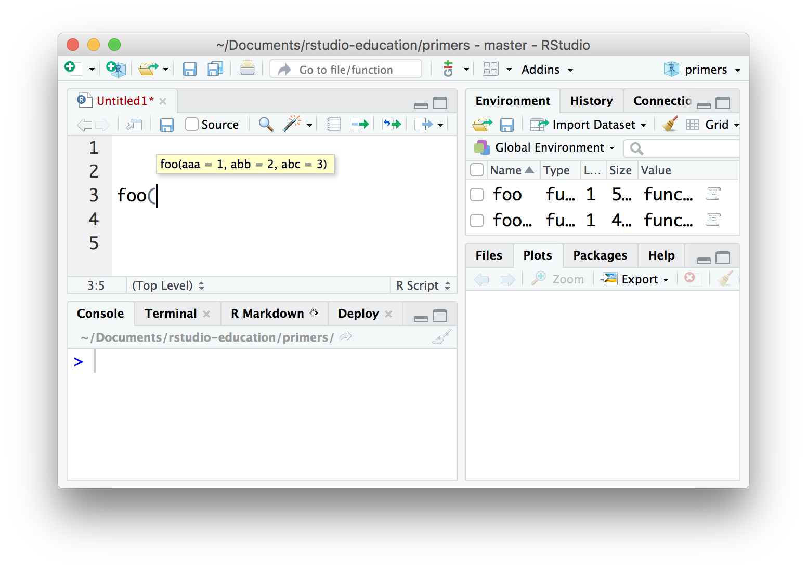
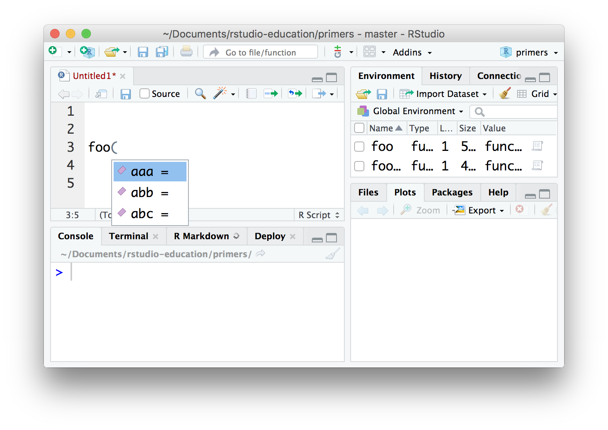



```{r}
#| include: false
knitr::opts_chunk$set(error = TRUE, out.width = "100%")
```

## Matching Quiz


Assigning the right values to the right arguments can make or break your code. 

```{r}
log(1, 2)
log(2, 1)
## Uh oh.
```

But how much do you know about assigning arguments? Take this quiz to find out.

### methods

::::: {.quiz type="multiple" correct="Good job! R can match values to arguments in three ways, but some of these methods are more foolproof then others." allow-retry="true" incorrect="Did you check _every_ method that works?"}
Which method(s) can you use to match values to arguments? (Check all that apply.)

:::: {.answer correct="true"}
Complete names (e.g. na.rm = TRUE)
::::

:::: {.answer correct="true"}
Partial names (e.g. na = TRUE)
::::

:::: {.answer}
Numbers (e.g. 2 = TRUE)
::::

:::: {.answer correct="true"}
Position (e.g. TRUE)
::::

:::::


### Not matching

Consider this brilliant function:

```{r}
foo <- function(aaa, abb, abc) {
  c(aaa, abb, abc)
}
```

::::: {.quiz allow-retry="true"}
What will `foo()` return?

:::: {.answer}
[1] "aaa" "abb" "abc"
::::

:::: {.answer correct="true"}
An error

::: {.message}
`foo` will not be able to find a value for `aaa` (or the rest).
:::
::::

:::::


### Default values

Let's make `foo` even more brilliant:

```{r}
foo <- function(aaa = 1, abb = 2, abc = 3) {
  c(aaa, abb, abc)
}
```

::::: {.quiz allow-retry="true"}
Now what will `foo()` return?

:::: {.answer}
[1] "aaa" "abb" "abc"
::::

:::: {.answer correct="true"}
[1] 1 2 3

::: {.message}
An argument with a default value is optional, R will use the default value if you do not provide one.
:::
::::

:::: {.answer}
An error
::::

:::::


::::: {.quiz allow-retry="true" incorrect="Is that the only way?"}
Which of these could you run to see the names and default values of `foo`'s arguments?

:::: {.answer}
`foo`
::::

:::: {.answer}
`?foo`
::::

:::: {.answer}
`formals(foo)`
::::

:::: {.answer}
`args(foo)`
::::

:::: {.answer correct="true"}
All of the above.

::: {.message}
Each of these will return output that contains `foo`'s argument names and default values (somewhere in the output).
:::
::::

:::::


### Position

Remember `foo`:

```{r}
foo <- function(aaa = 1, abb = 2, abc = 3) {
  c(aaa, abb, abc)
}
```

::::: {.quiz allow-retry="true"}
What will `foo(0)` return?

:::: {.answer}
[1] 1 2 3
::::

:::: {.answer correct="true"}
[1] 0 2 3

::: {.message}
If you do not provide an argument name in your call, R will match your value to the first unmatched argument name.
:::
::::

:::: {.answer}
[1] 1 0 3
::::

:::: {.answer}
[1] 1 2 0
::::

:::: {.answer}
[1] 0 0 0
::::

:::: {.answer}
An error
::::

:::::


```{r}
foo <- function(aaa = 1, abb = 2, abc = 3) {
  c(aaa, abb, abc)
}
```

::::: {.quiz allow-retry="true"}
What will `foo(0, 5)` return?

:::: {.answer}
[1] 1 2 3
::::

:::: {.answer correct="true"}
[1] 0 5 3

::: {.message}
I think you have the hang of position matching.
:::
::::

:::: {.answer}
[1] 0 5 0
::::

:::: {.answer}
[1] 0 5 5
::::

:::: {.answer}
An error
::::

:::::


### Names

```{r}
foo <- function(aaa = 1, abb = 2, abc = 3) {
  c(aaa, abb, abc)
}
```

::::: {.quiz allow-retry="true"}
What will `foo(aaa = 0, abc = 5)` return?

:::: {.answer}
[1] 1 2 3
::::

:::: {.answer}
[1] 0 5 3
::::

:::: {.answer}
[1] 0 5 0
::::

:::: {.answer correct="true"}
[1] 0 2 5

::: {.message}
Using complete argument names is the easiest way to avoid an error (and to write comprehensible code). But what if you use a partial argument name?
:::
::::

:::: {.answer}
An error
::::

:::::


### Partial names

```{r}
foo <- function(aaa = 1, abb = 2, abc = 3) {
  c(aaa, abb, abc)
}
```

::::: {.quiz allow-retry="true"}
What will `foo(aa = 0)` return?

:::: {.answer}
[1] 1 2 3
::::

:::: {.answer correct="true"}
[1] 0 2 3

::: {.message}
You do not need to spell out the full argument name, so long as you provide enough of the name to uniquely identify the argument. Here `aa` could only be the beginning of the `aaa` argument.
:::
::::

:::: {.answer}
[1] 0 0 0
::::

:::: {.answer}
An error
::::

:::::


```{r}
foo <- function(aaa = 1, abb = 2, abc = 3) {
  c(aaa, abb, abc)
}
```

::::: {.quiz allow-retry="true"}
What will `foo(a = 0)` return?

:::: {.answer}
[1] 1 2 3
::::

:::: {.answer}
[1] 0 2 3
::::

:::: {.answer}
[1] 0 0 0
::::

:::: {.answer correct="true"}
An error

::: {.message}
Here `a` does not uniquely match an argument name: it is the beginning of all three argument names. R isn't psychic, so it won't guess which argument you meant. Instead R returns an error. It's the right thing to do because it lets you fix your code.
:::
::::

:::::


### Dots

Now for some dark magic:

```{r}
foodoo <- function(...) {
  c(...)
}
```

::::: {.quiz allow-retry="true"}
What will `foodoo(1, 2, 3)` return?

:::: {.answer correct="true"}
[1] 1 2 3

::: {.message}
`...` is a special mechanism for passing arguments. `...` will match any argument not otherwise matched and pass those arguments on as a group. This is a convenient way to pass a set of arguments through to a function in the function body.
:::
::::

:::: {.answer}
An error.
::::

:::: {.answer}
Oh my goodness! You've broken R!
::::

:::::


```{r}
foodoo <- function(...) {
  c(...)
}
```

::::: {.quiz allow-retry="true"}
What will `foodoo(a = 1, b = 2, c = 3)` return?

:::: {.answer}
[1] 1 2 3
::::

:::: {.answer correct="true"}
[1] 1 2 3 _but with the names a b c above the values_

::: {.message}
If you provide names to your values, `...` will capture those as well and pass them on. So here, our code essentially runs `c(a = 1, b = 2, c = 3)`.
:::
::::

:::: {.answer}
An error.
::::

:::::


Here is one last wrinkle. Suppose we rewrite `foodoo` slightly:

```{r}
foodoo <- function(a, ...) {
  c(...)
}
```

::::: {.quiz allow-retry="true"}
What will `foodoo(a = 1, b = 2, c = 3)` return?

:::: {.answer}
[1] 1 2 3 with the names a b c above the values
::::

:::: {.answer correct="true"}
[1] 2 3 with the names b c above the values

::: {.message}
Remember that `...` only captures _unmatched_ values. Now that `a` is a formal argument, `a = 1` will be matched to it, leaving `b = 2` and `c = 3` to be captured and passed on.
:::
::::

:::: {.answer}
An error.
::::

:::::


## Tips


Congratulations! You've finished the quiz and know a lot about how R parses arguments. As a reward, here are two useful things that you can do with arguments in the RStudio IDE:


After you've written a function name followed by an opening parenthesis, look for a small yellow window to pop up that tells you the names, order, and default values of the function's arguments. This can be handy when you are not very familiar with the function.

```{r echo=FALSE, out.width = "100%"}

```


After you've written a function name followed by an opening parenthesis, press tab to invoke RStudio's tab completion. RStudio will open a pop up menu that contains the names of the function's arguments. Use the up and down arrow keys to navigate to a name, and then press enter to insert the name into your code. This can save you a lot of time once you get a feel for it.

```{r echo=FALSE, out.width = "100%"}

```


